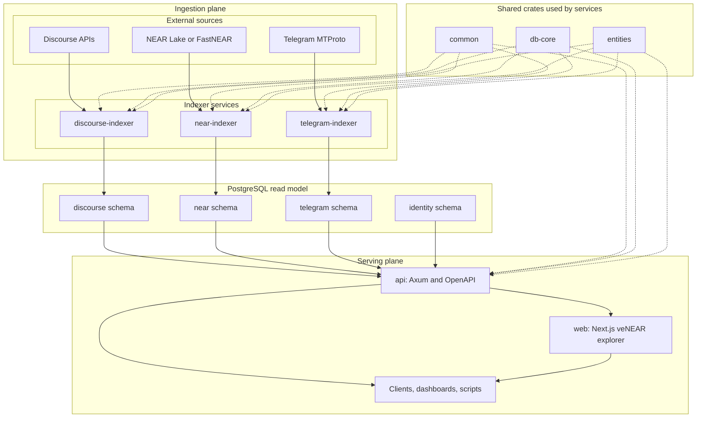

# Indexers, API, and Web Architecture

This workspace uses a CQRS-like separation: indexers ingest and normalize
external data into PostgreSQL, the API serves that indexed state through a
read-only HTTP contract, and the Next.js web app consumes the API as a
separately deployable frontend. Services share configuration, DB, and entity
contracts where appropriate, but ship independently.

## Architecture Principles

- **Monorepo contract integrity:** Keeping indexers, API, and shared database/model packages in one monorepo helps maintain data contracts as a single change unit; schema/entity/indexer/API updates can be coordinated in one PR.
- **Write/read separation with independent scaling:** Indexers own writes into the read model, while the API is read-only; each can be deployed and scaled with separate knobs based on ingest vs read load.
- **Schema-per-source boundaries:** Data is separated by source-oriented PostgreSQL schemas (`discourse`, `near`, `telegram`, `identity`) to reduce coupling and keep ownership boundaries clear.
- **Source-fidelity storage:** Indexed records stay as close as practical to source truth; light normalization is acceptable for queryability, but source meaning is not rewritten.
- **Stable API evolution:** API v1 evolves additively by default, and cross-schema access is done through curated handler logic rather than unrestricted query patterns.
- **Eventual consistency by design:** The API serves indexed state, so freshness follows ingestion progress instead of direct source-system real-time guarantees.
- **Resumable ingestion and replay safety:** Each indexer owns backfill/replay behavior with idempotent writes and cursor-based progress tracking for safe restarts.
- **Failure isolation and observability:** Indexer failures should impact freshness, not API availability; shared telemetry/logging conventions make cross-service behavior easier to operate.
- **Data integrity and verification posture:** Rust's explicit typing and error handling encourage safer data paths, and tests combine realistic fixtures or source-aligned coverage with real PostgreSQL runs through testcontainers.

## System Flow

## Responsibilities Matrix

| Component | Primary responsibility | Reads from | Writes to | Key paths |
|---|---|---|---|---|
| `discourse-indexer` | Multi-instance Discourse ingestion (full, recent, directory/metrics refresh cycles) | Discourse HTTP APIs + cursor/state from DB | `discourse` schema | `indexers/discourse-indexer/src/main.rs`, `indexers/discourse-indexer/src/sync.rs` |
| `near-indexer` | Modular chain indexing (`raw` and `venear_governance`) with stream assignment, restart rewind, and cursor resume | NEAR Lake/FastNEAR + module cursors from DB | `near` schema | `indexers/near-indexer/src/main.rs`, `indexers/near-indexer/src/lib.rs`, `indexers/near-indexer/src/modules/mod.rs`, `indexers/near-indexer/src/core/cursor.rs` |
| `telegram-indexer` | Channel-based historical sync plus realtime Telegram updates | Telegram MTProto + channel/cursor state from DB | `telegram` schema | `indexers/telegram-indexer/src/main.rs`, `indexers/telegram-indexer/src/sync/mod.rs` |
| `api` | Read-only REST access with cursor pagination and OpenAPI docs | PostgreSQL indexed data | No domain writes | `api/src/main.rs`, `api/src/routes.rs`, `api/src/handlers/discourse/mod.rs`, `api/src/handlers/telegram/mod.rs`, `api/src/handlers/venear/mod.rs`, `api/src/handlers/identity/mod.rs`, `api/src/docs.rs` |
| `web` | Next.js App Router frontend for veNEAR governance views | `api` over HTTP | No domain writes | `web/src/app`, `web/src/components/venear`, `web/src/lib/venear-api.ts` |

`identity` is also part of the read model served by `api`; in this repo it is populated by migration/backfill workflows (for example, the `backfill-identity-accounts` cargo alias) rather than a dedicated long-running indexer.

## API Architecture

The API process composes route modules under `/api/v1`, keeps the legacy Agora compatibility surface under `/api/agora`, and serves Swagger/OpenAPI from the same binary (`api/src/main.rs`, `api/src/routes.rs`, `api/src/docs.rs`). Handlers are grouped by domain and consistently use bounded cursor pagination and typed DTOs (`api/src/handlers/*`, `api/src/types.rs`). `AppState` holds an optional DB connection (`api/src/state.rs`), which lets the process still boot while reporting degraded DB availability in health behavior.

## Web Architecture

The web app is a separate Next.js App Router service that reads the veNEAR API
through `web/src/lib/venear-api.ts`. It is intentionally thin: server-rendered
pages fetch canonical API DTOs, client components mainly handle visualization
and interaction, and deployment configuration is isolated in `web/Dockerfile`
and `web/railway.toml`.

## Indexer Architecture

`discourse-indexer` runs per-instance workers with independent schedules for full refresh, recent delta sync, and directory users/metrics sync. Concurrency limits are configurable per instance, and each cycle is guarded to avoid overlapping runs (`indexers/discourse-indexer/src/main.rs`, `indexers/discourse-indexer/src/sync.rs`).

`near-indexer` is module-driven: modules register through a shared `IndexerModule` contract, can run on shared or independent streams, and recover from persisted cursors before worker startup (`indexers/near-indexer/src/lib.rs`, `indexers/near-indexer/src/main.rs`, `indexers/near-indexer/src/core/cursor.rs`). This keeps module logic isolated while allowing one runtime to orchestrate stream workers.

`telegram-indexer` authenticates once, resolves configured channels, then runs per-channel workers that combine backfill sync with live update handling. It uses bounded channel concurrency (semaphore), retry/backoff, and cancellation-aware shutdown (`indexers/telegram-indexer/src/main.rs`).

## Shared Foundations

Shared crates keep service contracts consistent: typed config + telemetry/log conventions in `shared/common/src/config.rs` and `shared/common/src/telemetry.rs`, DB connection/pool setup in `shared/db-core/src/connection.rs`, and generated SeaORM entities in `shared/entities/src/{discourse,near,telegram,identity}`.

## Why this is a good fit

- **Scalability:** read traffic (`api`) and ingestion throughput (indexers) can scale independently.
- **Maintainability:** source-specific complexity is isolated inside each indexer while the API remains a stable read layer.
- **Extensibility:** adding a new ingestion source typically does not require reworking existing indexers; it mostly adds a new writer plus API slices over new tables.

## Trade-offs

- **Operational complexity:** running multiple services means more process supervision, configuration surfaces, and observability coordination.
- **Backfill cost:** historical indexing can be time- and resource-intensive, especially for chain and message history workloads.

## How to extend (short path)

- Add or evolve schema/entities first (`migration/` + `cargo generate-entities` -> `shared/entities/`).
- Implement ingestion in an indexer crate using shared config/DB patterns (`shared/common`, `shared/db-core`) and persisted cursors.
- Expose read endpoints in `api/src/routes/*` + `api/src/handlers/*` and register OpenAPI metadata in `api/src/docs.rs`.
- If the feature is user-facing, wire it into `web/src/app` or
  `web/src/components/venear` using the typed API client in
  `web/src/lib/venear-api.ts`.
